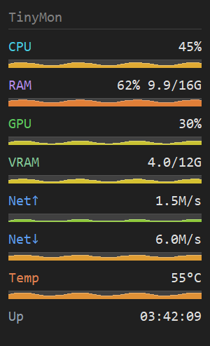

# TinyMon

A tiny always-on-top Windows resource monitor, written in pure Rust and Win32:
no Electron, no webview, no .NET, no scripting runtime. One small `.exe`
(about 279 KiB, nothing to install) shows the metrics you pick in a
borderless, semi-transparent widget, with a tray icon, two optional global
hotkeys and a native settings window with a live preview.



The parts of a row:

```text
+------------------------------+
| TinyMon                   +2 |   dim title; "+N" when rows do not fit the screen
|------------------------------|
| CPU                      37% |   accent-coloured label, value on the right
| ___..--''''--..___..--''---. |   sparkline of the recent samples
| RAM              58% 9.3/16G |
| ______..--------------''''-- |
| Intel UHD 730            12% |   one row per GPU
| __..___..__________..--__... |
+------------------------------+
```

## Metrics

Every metric can be switched on or off and put in any order in the settings
window. A metric that is off is not sampled at all: its counters are never
opened, so it costs nothing.

| Metric (config token) | Rows it shows | Source |
|---|---|---|
| CPU (`cpu`) | `CPU 37%`: total CPU load | `GetSystemTimes` deltas |
| RAM (`ram`) | `RAM 58% 9.3/16G`: memory load, used/total GiB | `GlobalMemoryStatusEx` |
| GPU (`gpu`) | one row per GPU, named after it (`Intel UHD 730 12%`): its busiest engine, summed across processes (Task Manager's GPU figure) | DXGI adapter list, PDH `\GPU Engine(*)\Utilization Percentage` |
| VRAM (`vram`) | one row per GPU: `GPU Mem 0.8/8G` for an integrated GPU, `VRAM 2.0/16G` for a discrete one; with several GPUs the name follows the label (`VRAM RTX 3050`, `GPU Mem UHD 620`) | PDH `\GPU Adapter Memory(*)\Dedicated Usage` and `Shared Usage`; totals from DXGI |
| Per-core CPU (`percpu`) | one row per logical core: `C0`, `C1`, ... | PDH `\Processor(*)\% Processor Time` |
| Disk (`disk`) | `Disk R` and `Disk W`: read and write bytes per second (bar against 100 MiB/s) | PDH `\PhysicalDisk(_Total)\Disk Read Bytes/sec`, `Disk Write Bytes/sec` |
| Network (`net`) | `Net↑` and `Net↓`: bytes per second sent and received (bar against 12.5 MB/s, about 100 Mbit/s) | `GetIfTable2` octet counters of the hardware network adapters |
| Uptime (`uptime`) | `Up 3d 04:12` (or `04:12:33` under a day), no bar | `GetTickCount64` |
| Battery (`battery`) | `Bat 85% 2:30` (time left), `Bat 72% chg` (charging) or `Bat 100% AC`; the bar shows the charge, green when full, red when low | `GetSystemPowerStatus` |
| Temperature (`temp`) | `ACPI Temp 45°C`, or `ACPI THRM 45°C` and the like with several zones; `Temp n/a` when no zone qualifies (see [Temperature](#temperature)) | PDH `\Thermal Zone Information(*)\Temperature` |

On by default: **CPU, RAM and GPU**, which is also what **Reset** in Settings
picks. The rest, Temperature included, are opt-in.

A reading that cannot be taken shows `n/a` with no bar instead of a misleading
0: for example GPU memory before Windows 10 1709, a disk or network counter
that fails, a desktop without a battery, or a machine without a hardware GPU
(`GPU n/a`, `VRAM n/a`).

## The widget

- **Rows.** Each row has the metric's accent-coloured label on the left (cut
  with an ellipsis when too long) and its value on the right, in one value
  column for all rows. Below it a bar shows the level, green to yellow to red.
  The widget updates every second by default (250 ms to 10 s, in Settings).
- **Sparklines.** Once a row has two samples, its bar becomes a sparkline of
  the last 64 samples (about a minute at the default interval), coloured by
  the newest one. A tick that reads `n/a` pauses the line instead of dropping
  it to zero. The series follow their rows when you reorder metrics or apply
  settings. The battery always draws a plain level bar.
- **Red label.** A load row (CPU, RAM, GPU, GPU memory, per-core CPU,
  temperature) turns its label red at 90% or more (90 °C for a temperature).
  Disk, network and battery never do: a fast download is not an alarm.
- **Pending marker.** CPU, per-core CPU, GPU, disk and network values are
  differences between two samples, so for up to a second after the start, and
  after a change to the metric list, they show `…` over an empty track instead
  of a made-up first value.
- **Size.** 200 px wide at the default 13 px font and 100% scaling; the width
  grows with the font. At that size the height is 36 px plus 36 px per row (3
  rows: 144 px). TinyMon is Per-Monitor-V2 DPI aware: it stays sharp and
  rescales when it moves to a monitor with another scaling.
- **+N.** The widget is never taller than its monitor's work area. When the
  rows do not fit, it shows the rows that fit, whole, and the header counts the
  rest (`+2`). The hidden rows are the last ones in your order, so put the
  important metrics above a long one such as per-core CPU.
- **Look.** Dark by default; menu, **Light theme** switches the widget to a
  light one. The opacity is set in Settings.

## Using it

| Action | How |
|---|---|
| Move the widget | drag it from anywhere |
| Menu | right-click the widget or the tray icon |
| Show / hide | left-click the tray icon (a double-click toggles once), menu, **Hide** / **Show**, or the Show / Hide hotkey |
| Settings | menu, **Settings...**, or the Open settings hotkey |
| Hide to the tray | Esc (click the widget first, so that it has the focus) or Alt+F4: it keeps running |
| Quit | menu, **Exit** (saves the settings and removes the tray icon) |

The menu: **Hide** (or **Show**), **Settings...**, **Lock (click-through)**,
**Move to corner** (top-left, top-right, bottom-left, bottom-right), **Light
theme**, **Start with Windows** and **Exit**.

- **Lock (click-through)** makes the widget ignore the mouse, so it never
  blocks a click on what is below it. While it is locked, use the tray icon's
  menu to unlock it. The lock is not saved: TinyMon starts unlocked.
- **Move to corner** puts the widget in a corner of its monitor's work area,
  24 px from the edges (scaled with the display).
- Showing the widget never activates it, so it does not take the keyboard
  focus from the app you are in: not from the tray, the hotkey, at start or on
  a second launch.
- The tray icon is drawn at the taskbar's icon size, so it stays sharp at any
  scaling. It comes back after Explorer restarts, and a failed add is retried
  every 2 seconds, up to 10 times.

**Where the widget goes.** The widget's home is the spot you chose: where you
dropped it after a drag (a click that does not move it changes nothing), or the
corner you picked. On the first run it is the top-right corner of the primary
monitor. When home does not fit the screen any more (a monitor is missing,
asleep or set to another resolution, or the taskbar moved), the widget is
placed inside the nearest work area and home is kept, so the widget goes back
when home fits again. When the widget grows or shrinks (a new font, more or
fewer rows), the edges nearest to the screen's edges stay put, so a widget in a
corner grows away from it. Home, the widget's top-left corner, moves along when
the change is yours (a new font or other metrics) and the widget sits at home.
When rows come or go while TinyMon runs (a thermal zone that proves itself,
say), home stays where it was, so every launch starts from the same spot; a
widget that grew this way goes back to home's top-left when the screen layout
changes.

**One TinyMon at a time.** One TinyMon runs per logon session: starting
TinyMon again, from any copy, brings the running widget back (shown, at home,
with its tray icon) and the new launch ends. So two portable copies in different folders cannot run at the same
time. A launch at normal rights next to a TinyMon that runs as administrator
does run as a second instance (Windows does not let it reach the first). A
debug build always runs, for development.

## Settings

**Settings...** opens one settings window (asking again brings it to the
front). It is always dark (TinyMon draws its buttons, checkboxes and slider
itself; **Light theme** changes only the widget), and it opens inside the work
area of the nearest monitor. Changes apply live on **Apply** or **OK** and are
saved; **Cancel**, Esc or closing the window drops them.

- **Metrics**: every metric in one list, the enabled ones first in their
  display order. The checkbox switches a metric on or off; the ▲ and ▼ buttons
  move it up or down, and the keyboard focus moves with it, so pressing Space
  or Enter again keeps moving the same metric. A double-click moves it two
  rows. The arrows belong to the rows: a click acts on the metric that is in
  that row now.
- **Appearance**: the opacity slider (40-255) with its value, the update
  interval (250-10000 ms) and the font size (9-16 px). The two boxes take
  digits: a number out of range is set to the nearest end of the range, any
  other text keeps the current value, and after Apply each box shows the value
  that applies. The font scales the whole widget: taller rows and a wider
  window.
- **Hotkeys**: a field and a **Clear** button for each hotkey, Show / Hide and
  Open settings, with a note at the right end of the field's label row when
  there is something to know
  (see [Hotkeys](#hotkeys)).
- **Live preview**: the real widget renderer at the widget's true size, with
  sample values (it opens no counters). It follows the metric list, the order,
  the opacity and the font as you change them, in the widget's light or dark
  theme. Only a layout taller than its pane is scaled down, and it never shows
  `+N`.
- **Reset** fills the controls with the defaults (CPU, RAM and GPU, opacity
  220, 1000 ms, 13 px, no hotkeys); it applies nothing until Apply or OK.

Keyboard: Tab and Shift+Tab move between the controls, Space toggles a checkbox
or presses a button, Enter presses the focused button (Reset, Clear, Apply,
Cancel, an arrow) and means OK anywhere else, and Esc cancels. When you come
back to the window, the focus returns to the control you left.

The window follows the scaling of the monitor it is on. On a screen 768 px
tall at 125% scaling or more it is taller than the work area: it keeps its top
edge on the screen.

## Hotkeys

Two optional global hotkeys, **Show / Hide** and **Open settings**. In
Settings, click a field and press the combo; **Clear** removes it.

- **Bare keys are allowed**, but Windows then gives the key to TinyMon in
  every app: it stops reaching any other program. The note **Blocks typing
  this key** (amber) marks a key that types text (a letter, a digit, a
  punctuation key, Space, Enter, ...), bare or with Shift only. Other bare
  keys (Esc, Delete, the arrows, the F keys, media keys) are taken the same way,
  without a note.
- **Win combos are set in the config file only.** The Windows hotkey field
  cannot show or capture the Win key. A Win combo from `tinymon.cfg` shows in
  its field without Win, with the note **+ Win (set in config)**, and Apply
  keeps it as long as the field still reads it that way. A Win combo typed
  into a field, or moved there from the other action, is saved without Win.
  So to change a saved `Win+Ctrl+T` to `Ctrl+T`, clear the field and Apply,
  then set the new combo and Apply again (or edit the file).
- **One combo cannot serve both actions.** Settings refuses it: the note
  **Same as Show / Hide** appears, OK keeps the window open and Apply does
  nothing until one of the two fields changes. A config file edited by hand to
  use one combo for both gets only the first registered.
- **A combo another app holds** cannot be registered. At startup this fails
  silently; the field then shows **In use by another app**. Every Apply tries
  the failed combos again, and a message box lists the combos changed in that
  Apply that still failed.
- **TinyMon's own combos can be moved.** While a hotkey field has the focus, a
  combo TinyMon has registered goes into the field instead of running its
  action.
- While a field has the focus, pressing Shift, Ctrl or Alt alone (as in
  Shift+Tab or Alt+Tab) does not wipe it, and Tab, Enter and Esc still move
  through the window. Arrow and navigation keys show under their own names
  (`Left`, not `Num 4`). The Windows field shows a saved Pause with an empty
  name and Print Screen as `Sys Req`.

In the config file a hotkey is optional modifiers (`Ctrl` or `Control`, `Alt`,
`Shift`, `Win` or `Super`) and exactly one key, joined with `+`, in any case:
a letter, a digit, `F1` to `F24`, or a virtual-key code in hex for any other
key (`0xDD` is `]` on a US keyboard, `0x25` the Left arrow). TinyMon writes
them back as `Ctrl+Alt+Shift+Win+Key`. A hotkey line it cannot read (an unknown
key, two keys such as `Ctrl+A+B`) binds nothing and is dropped at the next
save.

## Temperature

Windows has no vendor-neutral CPU temperature interface for a normal user
process. TinyMon reads two sources, neither of which needs admin rights or other
software:

- **GPU temperatures**, the way Task Manager reads them (the adapter performance
  data of D3DKMT; Task Manager shows it from Windows 10 2004 on, for
  dedicated GPUs). A GPU whose driver reports a temperature, which most NVIDIA
  and AMD graphics cards do, gets a row once it has: `GPU`, or `GPU` and its
  name when several GPUs report. Integrated GPUs usually report none and get
  no row. A laptop's dedicated GPU that sleeps to save power reports none while
  it sleeps, so its row reads `n/a` then. The GPU rows come first.
- **The ACPI thermal zones** that Windows publishes through PDH
  (`\Thermal Zone Information(*)\Temperature`):

  - A zone is shown only once its reading has changed (by at least one kelvin,
    the counter's step). Many desktop boards publish a firmware stub that
    reads the same value at any load, and a reading that never moves says
    nothing. Once a zone has moved it stays shown until TinyMon exits, also
    after a change in Settings.
  - The labels say what is read: `ACPI Temp` for a board's only zone,
    otherwise `ACPI` and the zone's firmware name (`ACPI THRM`). A zone is
    never called "CPU Temp": what it measures is up to the firmware.

With nothing to show, the metric keeps one `Temp n/a` row, so you can see it is
on; on many desktops without a dedicated graphics card that is all it shows. A
shown GPU or zone that misses a reading reads `n/a` for that moment, so the
widget keeps its size. Readings outside 1-150 °C are ignored. Temperature is
off by default, and TinyMon does not use LibreHardwareMonitor.

The metric is behind the `temp` Cargo feature, which is on by default; a build
with `--no-default-features` has no Temperature metric and no `temp` token.

## GPU and GPU memory

GPU support is vendor-neutral by design: every non-software adapter that DXGI
finds is shown (discrete or integrated, AMD, Intel or NVIDIA; the Microsoft
Basic Render Driver is skipped), using only DXGI and Windows' own PDH counters,
the sources Task Manager reads. No vendor SDK (ADLX, NVML, ...) is involved,
so one exe behaves the same on a gaming PC and on a laptop with integrated
graphics.

- **Load**: each process gets its own `GPU Engine` instance per engine.
  TinyMon adds up the processes on each engine and shows the busiest engine,
  which is what Task Manager calls the GPU's load. Each GPU counts only its own
  engines, matched by its adapter LUID.
- **Memory**: from the adapter-wide `GPU Adapter Memory` counters (Windows 10
  1709 or later). An integrated GPU, which uses shared system memory, shows
  `GPU Mem`: dedicated plus shared usage out of dedicated plus shared memory,
  Task Manager's "GPU memory". A discrete GPU shows `VRAM`: dedicated usage out
  of its dedicated memory. Integrated or discrete is decided from the memory
  budgets DXGI reports. The settings list and the config token still say VRAM
  (`vram`).
- The GPU's name is shortened: `Intel(R) UHD Graphics 730` reads
  `Intel UHD 730`, `AMD Radeon RX 9070 XT` reads `RX 9070 XT`, and a Ryzen's
  `AMD Radeon(TM) Graphics` reads `Radeon`.

## Network

The network rows add up the traffic of the hardware network adapters only, read
from `GetIfTable2`. Virtual adapters, VPN adapters and filter drivers do not
count, so traffic that passes through two of them is not counted twice. In a
virtual machine whose adapter does not say it is hardware, the adapters with a
connector count instead; with neither, the rows read `n/a`. Traffic that never
reaches a physical adapter (loopback, a host talking to WSL or a Hyper-V
internal switch) is not counted.

## Configuration file

Everything is saved to `tinymon.cfg`, a small `key=value` text file.

**Where.** Next to the `.exe` when that folder is writable (decided by a real
test write), which makes TinyMon portable, for example on a USB stick.
Otherwise in `%APPDATA%\TinyMon\tinymon.cfg` (a read-only stick, `C:\Program
Files`).

**Which file is read.** TinyMon looks for both files. A portable install reads
its own file first; a `%APPDATA%` file then only seeds its first run. An install
that saves to `%APPDATA%` reads whichever of the two files is newer. A file
that is missing or cannot be read is skipped; with none, the defaults apply.

**Format.** One `key=value` per line. Blank lines, lines starting with `#` and
trailing `# ...` comments are ignored, as are spaces around keys and values,
unknown keys and lines without `=`. The file may be UTF-8 (with or without a
BOM), ANSI, or UTF-16 with a byte order mark (what PowerShell 5.1's `Out-File`
writes). TinyMon rewrites the whole file whenever it saves (for example after
a drag, Move to corner, the theme or an Apply, and on Exit), in its own key
order and without your comments. It saves by writing `tinymon.cfg.tmp`,
flushing it to disk and renaming it over `tinymon.cfg`, so a crash leaves the
old file or the new one, never a half-written one; if the rename is refused
(another program holds the file), it writes the file in place instead. A
failed save is not reported.

An annotated example:

```ini
x=100                     # the widget's home (set when you drag it)
y=24
metrics=cpu,ram,gpu       # which metrics to show, in order
opacity=220               # 40–255
interval_ms=1000          # 250–10000
font_px=13                # 9–16
hotkey_toggle=Ctrl+Alt+M  # optional; e.g. Ctrl+Shift+F1
hotkey_settings=Ctrl+Alt+S
```

| Key | Meaning | Values (default) |
|---|---|---|
| `x`, `y` | the widget's home: its top-left corner in desktop pixels (negative on a monitor left of or above the primary one) | whole numbers; both are needed; written on the first run and whenever home changes |
| `metrics` | the enabled metrics, in display order | `cpu`, `ram`, `gpu`, `vram`, `percpu`, `disk`, `net`, `uptime`, `battery`, `temp`, separated by commas (`cpu,ram,gpu`). Unknown tokens are ignored and a repeated one counts once; `metrics=` with nothing hides every metric; a file without `metrics` gets the default |
| `opacity` | how opaque the widget is | 40-255 (220); 0-39 reads as 40; a value that is not a number from 0 to 255 gets the default |
| `interval_ms` | the update interval, in ms | 250-10000 (1000); other whole numbers from 0 up are clamped; a negative value or one that is not a number gets the default |
| `font_px` | the font size, in px; the widget scales with it | 9-16 (13); other whole numbers are clamped; a value that is not a whole number gets the default |
| `hotkey_toggle` | the Show / Hide hotkey | a combo (none); see [Hotkeys](#hotkeys) |
| `hotkey_settings` | the Open settings hotkey | a combo (none) |
| `light` | the light widget theme | `true` or `false` (`false`); anything else reads as `false` |

A value TinyMon cannot read (not a number, say) falls back to its default.

## Start with Windows

The menu's **Start with Windows** uses the per-user Run key, so it needs no
admin rights:

```text
HKCU\Software\Microsoft\Windows\CurrentVersion\Run    TinyMon = "<full path of tinymon.exe>"
```

- The checkmark means that Windows starts **this** exe at logon: the Run value
  names its path (in quotes, or without them as earlier versions wrote it; the
  case of the letters A-Z does not matter), and Task Manager's Startup tab has
  not disabled the entry
  (`HKCU\Software\Microsoft\Windows\CurrentVersion\Explorer\StartupApproved\Run`,
  value `TinyMon`).
- Clicking an unchecked item points the entry at this exe, with the path in
  quotes, and clears Task Manager's disabled flag. That also repairs an entry
  left by an exe that has moved, one written by another copy, and one disabled
  in Task Manager. Clicking a checked item deletes the Run value.
- An unquoted path that contains a space (`C:\Program Files\...`, as earlier
  versions wrote it) shows unchecked, although Windows still starts it:
  unquoted, Windows could start another program instead. One click rewrites it
  in quotes.

## Requirements

To run:

- Windows 10 version 1703 or later, 64-bit. The DPI functions TinyMon uses are
  bound at load time, so an older Windows refuses to start the exe. The GPU
  memory rows need version 1709 (`n/a` before), and the settings window's dark
  title bar needs version 2004 (before that it keeps a light one).
- Nothing else to install. The Visual C++ runtime is linked into the exe, and
  the rest of the C runtime (the Universal CRT) is part of Windows 10, so no
  Visual C++ Redistributable is needed.
- No admin rights, no services or drivers, no network access. The exe declares
  `asInvoker` in its manifest.

To build:

- **Rust 1.96.0** with the **MSVC** toolchain (`x86_64-pc-windows-msvc`).
  `rust-toolchain.toml` pins that version, and rustup installs it on first use.
- **Visual Studio Build Tools** (the "Desktop development with C++" workload,
  for `link.exe` and the static Visual C++ runtime) and a **Windows 10/11 SDK**,
  whose resource compiler (`rc.exe`) builds `tinymon.rc`: the icon, the version
  information and the manifest. `build.rs` takes the `RC` environment variable,
  else `rc.exe` on `PATH`, else the newest one in the SDK. Without it the build
  still succeeds with a warning, but the exe has none of the three, and both
  the test `exe_embeds_minimal_manifest` and the release script fail.

`cargo` finds the MSVC linker by itself; no developer command prompt is needed.

## Build

```sh
cargo build --release                        # with the Temperature metric (default)
cargo build --release --no-default-features  # without it
```

The exe is `target\release\tinymon.exe`. Copy it anywhere and run it.

Sizes with Rust 1.96 and MSVC 14.51: **285,184 bytes** (278.5 KiB) for the
default build and 281,088 bytes without default features. The release profile
optimises for size (`opt-level = "z"`, LTO, one codegen unit,
`panic = "abort"`, stripped).

`build.rs` compiles `tinymon.rc`, which embeds `icon.ico` (icon resource 1,
also the settings window's caption icon), the version information (its
numbers come from `Cargo.toml`) and `tinymon.manifest`: run as the invoking
user (`asInvoker`), Windows 10 and 11, Per-Monitor-V2 DPI awareness. It also
links the Visual C++ runtime statically while the Universal CRT stays a
Windows DLL, and passes `/Brepro`, so that the same inputs give the same bytes.

## Releases

A release exe is built with the script that the release workflow runs. Windows
blocks unsigned scripts by default, so run it through `powershell
-ExecutionPolicy Bypass -File` (or `pwsh -File`):

```powershell
powershell -ExecutionPolicy Bypass -File scripts\build-release.ps1   # build into target\release, then check
powershell -ExecutionPolicy Bypass -File scripts\build-release.ps1 -NoDefaultFeatures
powershell -ExecutionPolicy Bypass -File scripts\build-release.ps1 -CheckOnly path\to\tinymon.exe
```

It hides the cargo home (whose path contains your user name) behind `/cargo`,
builds, and then fails if the exe imports the Visual C++ runtime, contains a
user or build path, lacks its icon, version information or manifest, carries
another version than `Cargo.toml`, or is larger than 286,720 bytes. It prints
the size, the SHA-256 and the tools used (rustc, the MSVC toolset, the
Windows SDK).

Releases are built by GitHub Actions (`.github/workflows/release.yml`) on a
version tag: the exe is built twice, on two runners from two checkout paths,
and is published only if both builds have the same bytes. A release holds:

- `TinyMon-<version>-windows-x64.zip`: `tinymon.exe`, this README and the two
  license files;
- `BUILDINFO.txt`: the SHA-256 of `tinymon.exe` and the tool versions the
  build used;
- `SHA256SUMS.txt`: the SHA-256 of the zip and of `BUILDINFO.txt`.

To verify a download, compare `Get-FileHash <file>` with `SHA256SUMS.txt`
(`sha256sum -c SHA256SUMS.txt` in a folder with both files), and the extracted
`tinymon.exe` with the `sha256:` line of `BUILDINFO.txt`. If the GitHub CLI is
installed, `gh attestation verify <file> --repo mthwSec/TinyMon` checks that
the zip, or the exe from it, was built by this repository's release workflow.
The same source built with `scripts\build-release.ps1` and the same tools gives
the same `tinymon.exe`, byte for byte, whatever the user name or folder (a
plain `cargo build` embeds the cargo home's path and gives other bytes). The
tools are rustc, the Windows SDK and the exact linker build, which the
`version:` line names (`linker 14.51.36260`); a serviced Visual Studio can hold
a newer linker under the same toolset version, and another linker build gives
other bytes. `scripts\build-release.ps1 -CheckOnly tinymon.exe` prints the
linker build of any copy, including the 1.0.0 release, whose `BUILDINFO.txt`
predates that line.

The exe is not code-signed, so on a first run Windows SmartScreen may show
"Windows protected your PC". Choose **More info**, then **Run anyway**.

## Tests

```sh
cargo test                          # 252 tests; 3 ignored: 2 diagnostics, the README picture
cargo test --no-default-features    # 232 tests, the same 3 ignored
cargo test -- --ignored --nocapture dump_   # print the detected GPUs and GPU engines
```

The tests cover the logic, most of it pure: the row formatters and the pending
marker, placement and the widget's home, the sparkline history and geometry,
the height cap, GPU load and memory, network deltas and adapter choice, PDH
failures, battery and temperature rules, config parsing, decoding, load order
and atomic saving, hotkey text, capture, routing and notes, the settings
window's layout and preview fit, the single-instance decision and the Start
with Windows matching. Some read the live system (PDH counters, DXGI, a
message-only window, the embedded manifest). The config tests use fixed folders
under `%TEMP%` (`tinymon_test_*`), so run one test suite at a time on a machine.

## Project structure

```text
build.rs            compiles tinymon.rc; links the static VC++ runtime and /Brepro
tinymon.rc          the resources: icon, manifest, version information
tinymon.manifest    asInvoker, Windows 10/11, Per-Monitor-V2
icon.ico            the exe's icon (resource 1)
rust-toolchain.toml pins Rust 1.96.0
rustfmt.toml        use_small_heuristics = "Max"
.gitattributes      LF line endings; icon.ico is binary
LICENSE-MIT         the MIT license
LICENSE-APACHE      the Apache License 2.0
scripts/
  build-release.ps1 the release build and its checks
.github/workflows/
  ci.yml            fmt, clippy, tests and the release checks on every push
                    to main and every pull request
  release.yml       the reproducible release build on a version tag
docs/design/        the designs of the correctness pass, the portable exe and
                    the UX polish
screenshots/        the README's picture (render_readme_picture renders it)
src/
  main.rs           the widget: window, message loop, paint, tray icon and menu,
                    placement and resizing, hotkeys, single instance, the
                    hand-off from the settings window
  registry.rs       the metric registry (MetricKey, MetricSource, build_sources,
                    collect_rows), the pending marker, the preview's sample rows
  render.rs         the shared renderer (widget and preview): layout, bars,
                    sparklines, the height cap and "+N"
  history.rs        sparkline history, kept per row identity
  placement.rs      where the widget goes: home, fitting a work area, resizing
                    from a corner, Move to corner
  settings.rs       runtime settings (defaults, clamps) to and from the config
  settings_win.rs   the settings window: layout table, controls, live preview,
                    hotkey capture and notes
  config.rs         tinymon.cfg: parse, decode, which file to read, atomic save
  hotkeys.rs        hotkey text, registration, the typing-key and retry rules
  startup.rs        Start with Windows (Run and StartupApproved values)
  dark.rs           the settings window's dark palette and dark-mode calls
  dpi.rs            Per-Monitor-V2 awareness, Scale (logical to device pixels)
  icon.rs           the tray icon, drawn at runtime
  metrics.rs        CPU and memory sampling, the load colours
  pdh.rs            the shared PDH counter helper
  gpu.rs            DXGI adapters, GPU load, GPU memory
  percpu.rs         per-core CPU
  disk.rs           disk read and write
  net.rs            network up and down
  battery.rs        battery
  temp.rs           the Temperature metric: GPU sensors, ACPI thermal zones (feature "temp")
  gputemp.rs        GPU temperatures through D3DKMT (feature "temp")
  fps.rs            why there is no FPS metric (documentation only)
```

## FPS: why it is not included

A per-application frame rate is a common request, but Windows offers no
vendor-neutral, user-mode, no-admin way to measure a specific game's render
rate, and every real approach gives up one of TinyMon's promises:

| Approach | Cost |
|---|---|
| **PresentMon / ETW** (how RTSS and CapFrameX work) | needs **Administrator** or the *Performance Log Users* group to open an ETW trace |
| **Bundling PresentMon.exe** | **several MB** (about 20 times TinyMon) and a second binary; still needs ETW rights |
| **Overlay injection** (Fraps or RTSS style) | **antivirus and anti-cheat tools flag it as malware**; fragile |
| **`DwmGetCompositionTimingInfo`** | no admin and tiny, but it is the **desktop compositor's** rate (about the monitor's refresh rate), not a game's |

So FPS is deliberately left out. [`src/fps.rs`](src/fps.rs) records the
reasoning and how a metric would plug in: behind a Cargo feature of its own,
as `temp` is, using PresentMon/ETW, documented to need elevation, and never by
injection.

## Antivirus note (false positives)

TinyMon is a small, **unsigned**, freshly compiled program that reads
performance counters and writes a registry Run value, a profile some heuristic
antivirus engines flag as a **false positive** (for example Symantec's
`Heur.AdvML.B`, or Microsoft Defender). It does nothing malicious: no network
access, and no files written outside its config's folder. If your antivirus
quarantines it (a build fails with *"Access is denied. (os error 5)"*, or the
`.exe` shows 0 KB or disappears), add a folder exclusion for the project or
output folder, or restore it from quarantine. Signing the binary would avoid
this for distribution.

## Implementation notes

- Pure Rust and the [`windows`](https://crates.io/crates/windows) crate
  (0.62.2), the only dependency, with only the crate features TinyMon uses.
  The build script uses std only: it runs the SDK's resource compiler itself.
- One UI thread, no worker threads. A metric that is off is never built.
- Every `unsafe` block carries a `SAFETY` comment on the Win32 call it makes.

## License

Licensed under either of the [Apache License, Version 2.0](LICENSE-APACHE) or
the [MIT license](LICENSE-MIT), at your option.
